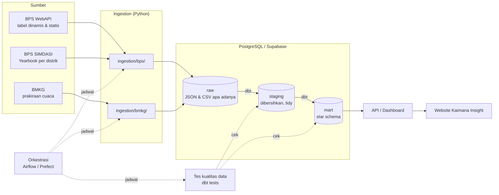
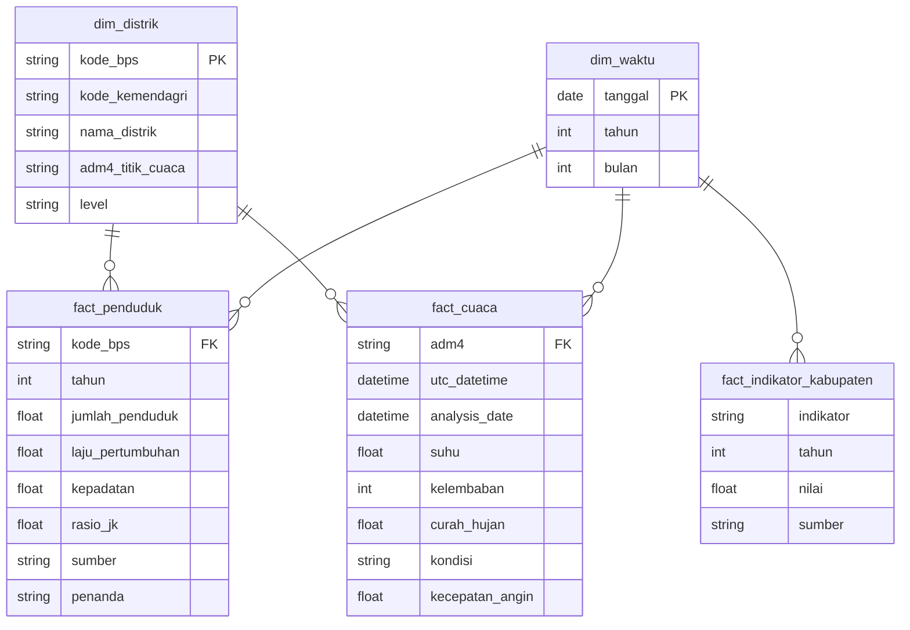

# Arsitektur — Kaimana Data Pipeline

> Tahap 1 (Perencanaan & Desain) · disusun 24 November 2026

## Alur data

## Lapisan data

| Lapisan | Isi | Aturan |
|---|---|---|
| **raw** | Respons API mentah (JSON) dan hasil parse awal (CSV), diberi nama per tabel & tahun | Tidak pernah ditimpa atau diubah |
| **staging** | Angka sudah numerik, satuan dikonversi (mis. "ribu" → jiwa), kode wilayah distandarkan, penanda BPS dipisahkan | Satu tabel staging per sumber |
| **mart** | Star schema siap dianalisis | Menjawab langsung pertanyaan bisnis |

## Rancangan awal star schema (mart)

## Jadwal (Tahap 6)

| Job | Jadwal | Isi |
|---|---|---|
| `bmkg_harian` | Setiap hari | Tarik 7 titik cuaca → raw → staging → mart |
| `bps_bulanan` | Setiap bulan | Cek SIMDASI (health check) → tarik tabel baru → dbt run → dbt test |
